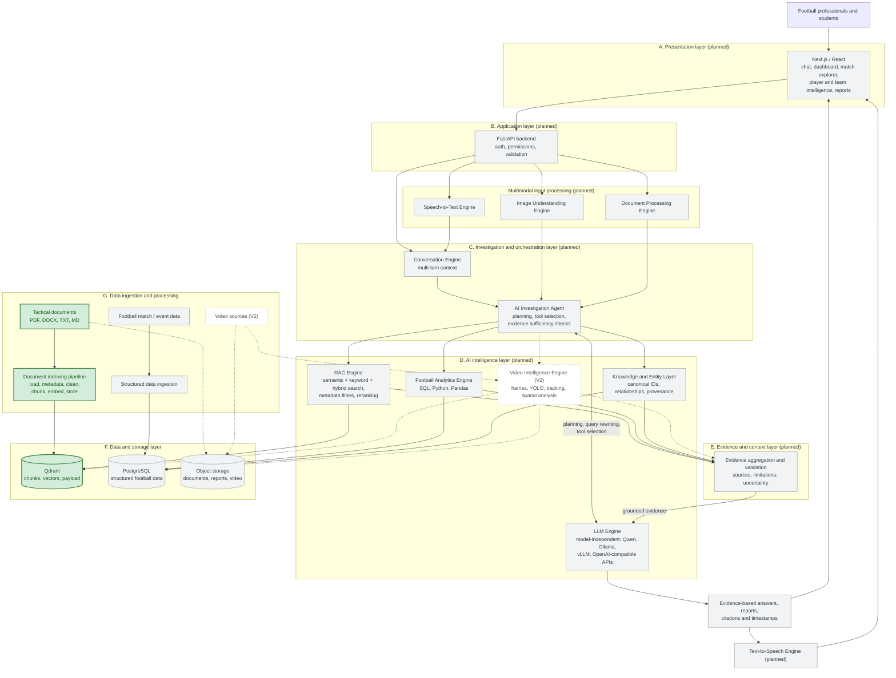
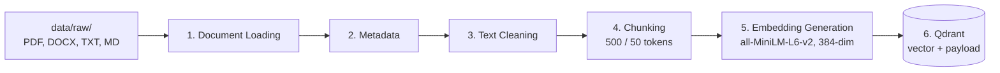

# TACTIQ — AI-Powered Football Intelligence Platform

**Ask football questions. Get evidence, not guesses.**

> **Status:** early development. Only the **document indexing pipeline** (data ingestion) is
> implemented. Everything else in this README describes the planned product and is labelled
> *Planned* / *Not implemented*.

---

## Table of contents

1. [Product overview](#1-product-overview)
2. [The problem](#2-the-problem)
3. [Why TACTIQ is more than a chatbot](#3-why-tactiq-is-more-than-a-chatbot)
4. [Who it is for](#4-who-it-is-for)
5. [Example questions](#5-example-questions)
6. [Key capabilities](#6-key-capabilities)
7. [System architecture](#7-system-architecture)
8. [V1 and V2 scope](#8-v1-and-v2-scope)
9. [The indexing pipeline (implemented)](#9-the-indexing-pipeline-implemented)
10. [Technology stack](#10-technology-stack)
11. [Project structure](#11-project-structure)
12. [Getting started](#12-getting-started)
13. [Running tests](#13-running-tests)
14. [Current development status](#14-current-development-status)
15. [Roadmap](#15-roadmap)
16. [Data sources and limitations](#16-data-sources-and-limitations)
17. [Accuracy and evidence principles](#17-accuracy-and-evidence-principles)
18. [Contributing](#18-contributing)
19. [License](#19-license)

---

## 1. Product overview

TACTIQ is an AI-powered football intelligence platform that helps football professionals,
researchers and students investigate matches, players, teams, statistics and tactical concepts
using reliable evidence.

A user asks a question in natural language, by text, voice, image, video clip or document.
TACTIQ plans an investigation, gathers evidence from structured football data, tactical
documents and (later) video, and answers with **sources, timestamps and an explicit statement
of what the evidence can and cannot support**.

## 2. The problem

Football knowledge is scattered across event data, statistics, scouting reports, tactical
documents, match video and staff notes. Answering one tactical question can mean hours of
searching through spreadsheets, PDFs and clips. General-purpose AI chatbots answer quickly,
but they often **invent statistics and tactical observations**, which is unacceptable when the
answer influences team selection, recruitment or a published article.

## 3. Why TACTIQ is more than a chatbot

| Simple chatbot | TACTIQ |
|---|---|
| Answers from the model's memory | Answers from retrieved, citable evidence |
| One modality (text) | Text, voice, image, video, documents, structured data |
| One step: question → answer | Multi-step investigation: plan → gather → validate → answer |
| No numbers it can verify | Statistics computed from data with SQL / Pandas |
| Confident even when unsure | Separates facts, evidence, observations, hypotheses and unknowns |
| Forgets the source | Keeps provenance for every piece of evidence |

## 4. Who it is for

| Audience | Typical use |
|---|---|
| **Football coaches** | Investigate tactical problems (e.g. struggles against a high press) and explore possible improvements. |
| **Scouts and recruitment teams** | Compare players and identify candidates that fit a playing style. |
| **Performance analysts** | Investigate match and player performance across phases of play. |
| **Journalists and sports analysts** | Prepare evidence-based match analysis with citable sources. |
| **Sporting directors and club management** | Support squad planning and strategic decisions with summarised evidence. |
| **Researchers and data scientists** | Explore football data and test hypotheses reproducibly. |
| **Educators and students** | Study tactical concepts and football analytics with grounded explanations. |

## 5. Example questions

- Why did Team A struggle against the opponent's high press?
- Which player lost possession most frequently?
- Why did attacking output decrease in the second half?
- Which players contributed most to build-up?
- What were the team's main defensive weaknesses?
- How did Team A and Team B differ tactically?
- Which players might fit a particular playing style?
- What evidence supports a tactical conclusion?

## 6. Key capabilities

*All capabilities below are **planned** unless marked otherwise.*

**Multimodal conversational assistant** — designed primarily for coaches, not a text-only chatbot:

| Modality | Planned capabilities |
|---|---|
| **Text** | Natural-language questions, multi-turn conversation, context-aware follow-ups, tactical investigations |
| **Image** | Tactical board photos, formation diagrams and tactical screenshots; extract visual information where technically possible |
| **Video** | Analyse match clips, identify relevant timestamps, link observations to events, players and teams when identification is reliable, generate clip summaries |
| **Voice / audio** | Speech-to-text questions, text-to-speech answers, hands-free conversation on the training ground |
| **Documents** | PDF, DOCX, TXT, Markdown tactical reports, scouting reports and match analyses — **ingestion implemented** |
| **Structured data** | Match, player, team and event statistics, comparisons and calculated metrics |

**Intelligence:** multi-step investigation planning, automatic evidence retrieval, tool selection
and orchestration, combining structured and unstructured information, player / team / match
comparisons, automatic summaries, evidence-based recommendations, source citations with
timestamps, and clear communication of uncertainty and missing evidence.

The aim is to save coaches time: TACTIQ should retrieve and organise the relevant statistics,
documents and clips so that users do not have to search through them manually.

## 7. System architecture

### 7.1 Diagram

Solid green = **implemented**. Grey = planned (V1). Dashed = planned (V2, video).



### 7.2 Layers

| Layer | Responsibility | Status |
|---|---|---|
| **A. Presentation** | Next.js / React UI: chat and investigation interface, dashboard, match explorer, player and team intelligence, reports; voice, image and video upload. | Planned |
| **B. Application** | FastAPI: API endpoints, authentication, permissions, request validation, business logic. | Planned |
| **C. Investigation and orchestration** | **Conversation Engine** keeps multi-turn context. **AI Investigation Agent** understands the question, plans the investigation, selects tools (RAG, analytics, entity lookup, video), orchestrates retrieval and SQL, aggregates evidence and checks whether it is sufficient. | Planned |
| **D. AI intelligence** | Five separate engines, described below. | Planned |
| **E. Evidence and context** | Combines retrieved documents and analytical results, preserves source references, validates sufficiency, records limitations and uncertainty, and passes grounded evidence to the LLM. | Planned |
| **F. Data and storage** | **Qdrant** stores chunk vectors and metadata payloads (**implemented**). **PostgreSQL** stores structured football data and relationships. **Object storage** keeps original documents, reports and video. | Qdrant implemented; others planned |
| **G. Data ingestion** | **Document indexing pipeline** (**implemented**). Structured football data ingestion and video ingestion are separate, future modules. | Partially implemented |

**AI intelligence layer components**

1. **LLM Engine** — understands questions, supports query planning and rewriting, helps the agent
   choose tools, interprets evidence, and generates grounded answers, summaries and reports.
   It is model-independent: Qwen, Ollama, vLLM or any OpenAI-compatible API can be plugged in.
2. **RAG Engine** — semantic search, keyword search, hybrid retrieval, metadata filtering,
   reranking and context construction over the Qdrant collection built by the indexing pipeline.
3. **Football Analytics Engine** — SQL queries, match / player / team statistics, comparisons and
   calculations with Python and Pandas. Numbers come from here, never from the LLM's memory.
4. **Knowledge and Entity Layer** — canonical IDs for teams, players, matches, competitions and
   events; relationships between entities; document references and provenance. This is what
   allows `match_id`, `team_id` and `player_id` in document metadata to be linked reliably.
5. **Video Intelligence Engine (V2)** — video ingestion, frame extraction, YOLO detection,
   object tracking, spatial calibration and movement analysis, producing video-derived
   observations linked to match, player and event IDs.

**Multimodal processing (planned)** is kept modular: Speech-to-Text, Text-to-Speech, Image
Understanding, Video Intelligence and Document Processing engines are independent components
the Investigation Agent can call. Each can use a different model or provider.

### 7.3 How a question will flow (planned)

1. The user asks *"Why did Team A struggle against the high press?"* (typed or spoken).
2. The Conversation Engine adds context from earlier turns; speech is transcribed first.
3. The Investigation Agent asks the LLM Engine to plan: which match, which data, which documents.
4. The agent calls the Football Analytics Engine (e.g. losses of possession in the own third),
   the RAG Engine (tactical reports on pressing) and the Knowledge Layer (resolve "Team A").
5. The Evidence Layer aggregates the results, keeps sources and flags gaps
   (e.g. "positional spacing cannot be verified from event data alone").
6. The LLM Engine writes an answer grounded only in that evidence, with citations.

## 8. V1 and V2 scope

### V1 — Evidence-based football intelligence (planned)

Football match and event data · player and team statistics · tactical documents and reports ·
document ingestion (**implemented**) · RAG · Qdrant (**implemented for storage**) ·
PostgreSQL analytics · keyword and vector retrieval · hybrid search · reranking ·
LLM-based grounded generation · AI Investigation Agent · multimodal conversational interface
(text, voice, image, documents) · evaluation · FastAPI backend · Next.js frontend · deployment.

### V2 — Video-based tactical intelligence (planned)

Video ingestion · frame extraction · player detection with YOLO · multi-object tracking ·
spatial calibration · movement analysis · video-derived tactical observations · linking video
observations to match, player and event IDs · video answers with relevant timestamps.

The indexing pipeline is designed so these modules can be added beside it without rewriting it:
each ingestion source (documents, structured data, video) is a separate module writing to its
own store, and the chunk payload already has optional `match_id`, `team_id` and `player_id` fields.

## 9. The indexing pipeline (implemented)

Code: [`indexing_pipeline/`](indexing_pipeline/) (see its [README](indexing_pipeline/README.md)).
The indexing pipeline runs **before** any user asks a question. It turns tactical documents into
searchable vectors in Qdrant.



| Step | Module | What it does |
|---|---|---|
| 1. Document Loading | `indexing_pipeline/src/indexing/step1_document_loading/` | Recursively discovers files; extracts text from PDF (one `Document` per page, page number kept), DOCX (paragraphs and tables), TXT and Markdown. Unsupported files are counted and skipped; corrupted files are recorded as failures without stopping the run. |
| 2. Metadata | `indexing_pipeline/src/indexing/step2_metadata/` | Stable `document_id` (UUID5 of the relative path), source name and path, file type, page. Optional `document_type`, `topic`, `language`, `match_id`, `team_id`, `player_id` come **only** from a human-written sidecar file `<file>.meta.json`; otherwise they stay `None`. Nothing is guessed. |
| 3. Text Cleaning | `indexing_pipeline/src/indexing/step3_text_cleaning/` | Unicode NFC normalisation, removal of control characters, collapsing repeated spaces and blank lines. Punctuation, case, numbers and terms such as `4-3-3` or `xG` are preserved. Each step can be switched off with `CleaningConfig`. |
| 4. Chunking | `indexing_pipeline/src/indexing/step4_chunking/` | Token-based fixed-size windows using the embedding model's own tokenizer (default 500 tokens, 50 overlap). Chunk text is sliced from the original text via token offsets, so case and spacing are preserved. Each chunk gets a stable `chunk_id`. |
| 5. Embedding Generation | `indexing_pipeline/src/indexing/step5_embeddings/` | Loads the Sentence Transformers model once, embeds in batches, L2-normalises vectors (so cosine similarity equals the dot product), reads the vector dimension from real model output and validates shape and finite values. |
| 6. Qdrant Storage | `indexing_pipeline/src/indexing/step6_vector_store/` | Creates the collection with the actual dimension and cosine distance, adds payload indexes, deletes a document's old chunks and upserts the new ones in batches. Re-ingesting the same files never creates duplicates. |

**Chunk payload stored in Qdrant**

```json
{
  "chunk_id": "01d88625-7dcc-5da4-ba2a-25c3e7d31f8b",
  "document_id": "…",
  "chunk_text": "Requirements and risks …",
  "source": "counterpressing.pdf",
  "source_path": "counterpressing.pdf",
  "file_type": "pdf",
  "document_type": "educational_sample",
  "topic": "counterpressing",
  "language": "en",
  "match_id": null,
  "team_id": null,
  "player_id": null,
  "page": 2,
  "chunk_index": 0,
  "token_count": 110,
  "embedding_model": "sentence-transformers/all-MiniLM-L6-v2"
}
```

**Known trade-off — chunk size vs. model limit.** `all-MiniLM-L6-v2` reads at most **256 tokens**
per input. With the default chunk size of 500, tokens after position 256 are not represented in
the vector (the full text is still stored in the payload). The pipeline prints a warning when this
happens. Set `TACTIQ_CHUNK_SIZE=256` and `TACTIQ_CHUNK_OVERLAP=25` to avoid truncation, or switch to
an embedding model with a longer context.

## 10. Technology stack

| Technology | Role | Status |
|---|---|---|
| Python 3.11 | Core implementation | In use |
| PyMuPDF | PDF text extraction | In use |
| python-docx | DOCX text extraction | In use |
| Hugging Face Transformers | Tokenizer for token-based chunking | In use |
| Sentence Transformers | Embedding generation (`all-MiniLM-L6-v2`) | In use |
| Qdrant (+ `qdrant-client`) | Vector database for chunks and metadata | In use |
| Docker Compose | Local Qdrant service | In use |
| python-dotenv | Configuration from `.env` | In use |
| pytest | Unit and integration tests | In use |
| PostgreSQL | Structured football data and relationships | Planned |
| Pandas | Football analytics | Planned |
| FastAPI | Backend API | Planned |
| Next.js / React | Frontend | Planned |
| LLM providers (Qwen, Ollama, vLLM, OpenAI-compatible) | LLM Engine | Planned |
| Speech-to-text / text-to-speech models | Voice interaction | Planned |
| YOLO + multi-object tracking | Video Intelligence (V2) | Planned |

The indexing pipeline is deliberately written by hand instead of with LangChain or LlamaIndex,
so every step is visible, testable and replaceable.

## 11. Project structure

```text
TACTIQ/
├── README.md
├── .env.example               # configuration template (copy to .env)
├── .gitignore
├── docker-compose.yml         # local Qdrant with a persistent volume
├── requirements.txt
├── pytest.ini
│
├── config/
│   └── settings.py            # all settings, read from environment variables
│
├── data/
│   ├── raw/                   # put your documents here (git-ignored)
│   ├── processed/             # chunks.jsonl written by the pipeline for inspection (git-ignored)
│   └── sample_docs/           # educational sample documents + .meta.json sidecars
│
├── indexing_pipeline/           # first pipeline — implemented (own README in Uzbek)
│   ├── src/indexing/
│   │   ├── step1_document_loading/      # document.py (Document), loader.py
│   │   ├── step2_metadata/              # metadata_builder.py
│   │   ├── step3_text_cleaning/         # cleaner.py
│   │   ├── step4_chunking/              # text_splitter.py
│   │   ├── step5_embeddings/            # embedding_model.py
│   │   ├── step6_vector_store/          # qdrant_store.py
│   │   └── pipeline.py            # connects the six steps
│   ├── scripts/                   # ingest_documents.py, inspect_collection.py
│   ├── notebooks/                 # indexing_pipeline.ipynb — step-by-step walkthrough
│   └── tests/                     # pytest unit + integration tests
│
├── retrieval_generation_pipeline/ # second pipeline — planned, same layout
│
└── Extra/                     # material kept for later use, not part of the TACTIQ package
```

Each pipeline is a self-contained folder (`src/`, `scripts/`, `notebooks/`, `tests/`, `README.md`),
so it can be studied on its own. Shared pieces stay at the root: `config/`, `data/`, `.env`,
`docker-compose.yml`. The retrieval pipeline will import `EmbeddingModel` and `QdrantStore` from
`indexing` rather than copying them, so documents and questions are always embedded with the same model.

Code comments and docstrings are written in Uzbek (Latin script) for educational use; technical
terms, identifiers and library names stay in English.

## 12. Getting started

### 12.1 Install

```bash
git clone https://github.com/davronbek-malikov/TACTIQ.git
cd TACTIQ
python -m venv .venv
# Windows: .venv\Scripts\activate      macOS / Linux: source .venv/bin/activate
pip install -r requirements.txt
```

The first run downloads the embedding model (about 90 MB) from Hugging Face.

### 12.2 Configure

```bash
cp .env.example .env      # Windows PowerShell: Copy-Item .env.example .env
```

| Variable | Default | Meaning |
|---|---|---|
| `QDRANT_URL` | `http://localhost:6333` | Qdrant server URL |
| `QDRANT_API_KEY` | empty | Needed for Qdrant Cloud or a secured server |
| `QDRANT_COLLECTION` | `tactiq_documents` | Collection name |
| `QDRANT_LOCAL_PATH` | empty | If set, use Qdrant local mode in this folder (no Docker) |
| `TACTIQ_RAW_DATA_DIR` | `data/raw` | Folder to ingest |
| `TACTIQ_EMBEDDING_MODEL` | `sentence-transformers/all-MiniLM-L6-v2` | Embedding model |
| `TACTIQ_CHUNK_SIZE` / `TACTIQ_CHUNK_OVERLAP` | `500` / `50` | Chunking, in tokens |
| `TACTIQ_EMBEDDING_BATCH_SIZE` | `32` | Texts per embedding batch |

Changing the embedding model changes the vector dimension: use a new collection name.

### 12.3 Start Qdrant

```bash
docker compose up -d qdrant
# Dashboard: http://localhost:6333/dashboard
```

Without Docker, set `QDRANT_LOCAL_PATH=qdrant_local` in `.env` to use Qdrant's embedded local mode
(fine for learning, not for production).

### 12.4 Ingest documents

```bash
# the bundled educational samples
python indexing_pipeline/scripts/ingest_documents.py --data-dir data/sample_docs

# your own documents in data/raw/
python indexing_pipeline/scripts/ingest_documents.py

# check what was stored
python indexing_pipeline/scripts/inspect_collection.py --limit 3
```

To attach optional metadata to a document, create a sidecar next to it, for example
`data/raw/high_press_report.pdf.meta.json`:

```json
{ "document_type": "tactical_report", "topic": "high_pressing", "language": "en",
  "match_id": null, "team_id": null, "player_id": null }
```

Only fill IDs you actually know. The script exits with code 1 if any file failed to load.

## 13. Running tests

```bash
pytest                                   # everything
pytest -m "not slow and not integration" # fast unit tests, no model download, no server
pytest -m integration                    # needs Qdrant at QDRANT_URL (skipped if unreachable)
```

Coverage: TXT / Markdown / PDF / DOCX loading, empty, unsupported and corrupted files,
text cleaning, chunk size and overlap, stable IDs, metadata preservation into the payload,
embedding dimension and normalisation, Qdrant collection creation, dimension checks, payload
storage, idempotent re-ingestion and removal of stale chunks, plus an end-to-end run on the
sample documents.

## 14. Current development status

| Module | Status |
|---|---|
| Document indexing pipeline (load → metadata → clean → chunk → embed → Qdrant) | ✅ Implemented and tested |
| Retrieval (semantic, keyword / BM25, hybrid, RRF, reranking) | Not implemented |
| LLM Engine and grounded generation | Not implemented |
| Football Analytics Engine (PostgreSQL, SQL, Pandas) | Not implemented |
| Structured football data ingestion | Not implemented |
| Knowledge and Entity Layer | Not implemented |
| Evidence aggregation and validation | Not implemented |
| AI Investigation Agent and Conversation Engine | Not implemented |
| Multimodal input (voice, image) | Not implemented |
| FastAPI backend, authentication | Not implemented |
| Next.js frontend | Not implemented |
| Evaluation | Not implemented |
| Video Intelligence (V2) | Not implemented |

## 15. Roadmap

1. **Indexing** — document ingestion into Qdrant ✅
2. **Retrieval** — query embedding with the same model, semantic search, metadata filters
3. **Search quality** — keyword search, hybrid retrieval with RRF, reranking
4. **LLM Engine** — provider-independent interface, grounded answers with citations
5. **Evaluation** — question sets, retrieval and answer-faithfulness metrics
6. **Structured data** — PostgreSQL schema, football data ingestion, Analytics Engine
7. **Knowledge and Entity Layer** — canonical IDs and links between documents and entities
8. **Investigation Agent** — planning, tool selection, evidence sufficiency checks, conversation
9. **Application** — FastAPI backend, Next.js frontend, voice and image input, deployment
10. **V2 Video Intelligence** — frames, YOLO, tracking, spatial analysis, timestamped observations

## 16. Data sources and limitations

- `data/sample_docs/` contains **educational sample material written for testing this
  pipeline**. It explains general tactical concepts and contains no real match data, statistics
  or observations about real teams or players. Do not cite it as football evidence.
- No real football datasets are bundled. Future structured data must come from sources whose
  licence allows the intended use; their terms will be documented when added.
- Text extraction is only as good as the source file. Scanned PDFs without a text layer yield
  empty pages (they are counted and skipped). OCR is not implemented.
- DOCX files have no stored page numbers, so `page` is `None` for them.
- Event data alone cannot reliably establish off-ball movement, exact spacing or full defensive
  positioning; these require tracking data or video.
- The default embedding model is English-centred and reads at most 256 tokens per chunk (see
  section 9).

## 17. Accuracy and evidence principles

TACTIQ must **never invent football statistics or tactical observations**. Every future answer
should distinguish between:

| Category | Example |
|---|---|
| **Verified fact / statistic** | A number computed from match data with a reproducible query |
| **Retrieved document evidence** | A passage from a cited report, with source and page |
| **Analytical observation** | An interpretation derived from the facts above |
| **Hypothesis** | A plausible explanation that the available data does not confirm |
| **Recommendation** | A suggested action, linked to the evidence behind it |
| **Cannot be verified** | Questions the available data cannot answer, stated explicitly |

These principles already shape the indexing pipeline: metadata is never guessed, entity IDs stay
empty unless provided, every chunk keeps its source, page and embedding model, and the ingestion
summary reports only measured counts.

## 18. Contributing

- Keep each pipeline step in its own module with a single responsibility.
- Prefer clear, small functions over clever abstractions; the code is also a learning resource.
- Explain important concepts in comments (Uzbek Latin, English technical terms).
- Add or update tests for every change; run `pytest` before opening a pull request.
- Never commit `.env`, API keys, large datasets, model weights or generated indexes.
- Use conventional commit prefixes: `feat:`, `fix:`, `docs:`, `refactor:`, `test:`.

## 19. License

**TBD** — no license has been chosen yet. Until one is added, all rights are reserved by the author.
